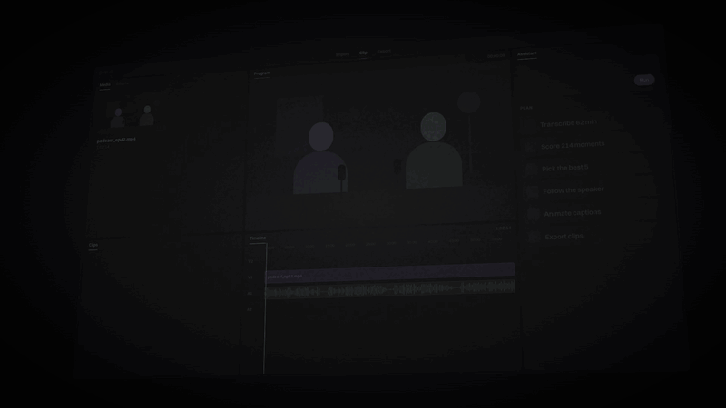
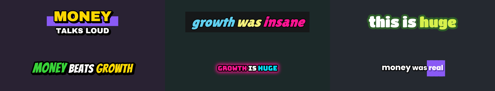
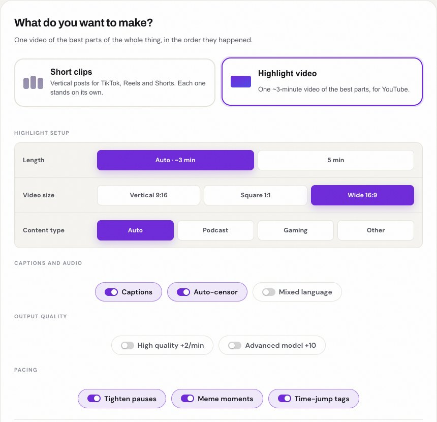
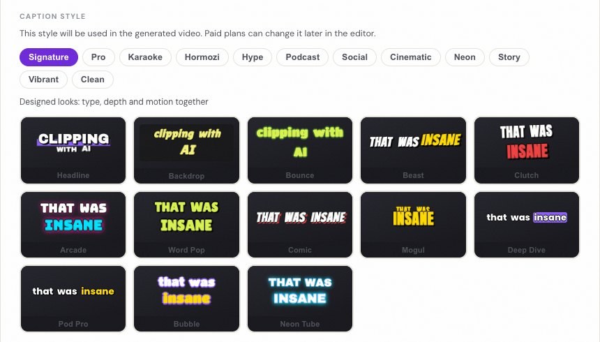

# KlipCut

AI-powered platform that turns long-form videos into short, viral-ready clips with burned-in captions, titles, and customizable layouts.

<p align="center">
  <a href="docs/media/klipcut-promo.mp4"></a>
</p>

**Two things it makes from one long video:**

- **Short clips** — vertical, captioned, framed on whoever is speaking, ready for TikTok, Reels and Shorts.
- **A highlight video** — one 8–15 minute cut of the best parts of a 1–3 hour stream or podcast, in story order, ready for YouTube (with chapters).

## How It Works

1. **Paste a URL or upload a video** — supports YouTube, TikTok, Twitter, and direct uploads
2. **AI analyzes the content** — transcribes with word-level timestamps, then identifies the most engaging moments using an LLM scoring rubric (hook strength, standalone value, emotion, shareability)
3. **Frames each clip for what it actually is** — the **Auto** template inspects the footage and picks a treatment per clip: podcast / talking head (face-tracked, speaker-aware), gameplay with a webcam, gameplay with no facecam (action-tracked), or screencast. The manual templates remain as overrides.
4. **Edit in the browser** — trim, restyle captions, change layouts, add overlays, adjust pacing — all with a live preview that matches the final export
5. **Export** — renders polished vertical clips ready for social media
6. **Or make a highlight video** — instead of clips, pick *Highlight video*: the best moments from across the whole source fill a time budget, then play in the order they happened, opened by a cold-open teaser, joined with quick transitions, optional meme beats and "25 MIN LATER" tags. Copy-ready YouTube chapters come with it.

### Podcasts

`pipeline/reframe.py` finds the faces, stacks simultaneous speakers into their own
tiles, and follows the shot as the edit cuts between angles. Diarization says
*who* is speaking; lip motion maps each voice to a position on screen, so the
clip can cut to the person actually talking instead of the person nearest the
camera. Framing is smoothed, dead-zoned and speed-limited so it reads as
camerawork rather than as a detector.

### Gaming

`pipeline/content.py` recognises a stream webcam — a small, fixed, persistent
face over fast-moving footage — and builds the composition stream clips use:
full-width gameplay on top (HUD, killfeed and minimap intact), the webcam below
at its native aspect with a blurred backdrop, and a caption band underneath.
With no facecam it tracks the action instead, using a centre-weighted motion
saliency map. Esports, GTA, and any other 16:9 capture are handled the same way,
because the decision is made from the frame, not from a per-game rule.

Gameplay with no commentary at all is supported: the moment picker falls back to
audio-visual peaks (motion + loudness) when there is no transcript, so a silent
VOD still produces clips.

### Captions

60+ presets grouped by cadence (karaoke, Hormozi, hype, podcast, social,
cinematic, neon, story, vibrant, clean) plus five house looks — **Pro Caps**
(uppercase white, black edge, light-blue spoken word — the reference style),
**Pro Glow**, **Pro Pop**, **Pro Chip**, **Pro Soft**. Word-level karaoke,
keyword colour, entrances, boxes, glow and gradient ramps.

Emoji are **full-color Twemoji PNGs composited by the renderer**, not font
glyphs. That is deliberate: libass on macOS cannot rasterise a color emoji face,
so a font-based emoji renders as an empty box. The PNG route also lets the emoji
sit where the reference puts it — floating above the caption block rather than
glued to the last word.

Density is editorially constrained. The model sees the cues and marks only the
few that genuinely need one (roughly one per ten seconds; most cues get none),
and a keyword matcher covers the same vocabulary when no API key is configured.
The artwork is rendered at 256px and composited with a soft drop shadow, so it
matches the reference instead of looking like a font fallback.

Every emoji is optional per clip: the editor's **Emoji** control switches them
off for that export without touching the captions. Missing artwork is fetched
once and cached; set `CLIPPER_EMOJI_FETCH=0` to stay offline, in which case an
emoji without local artwork is dropped rather than drawn blank.

Cadence and placement are editor controls too. **Words** chooses 1, 2 or 3
words on screen at a time; the caption block moves with the layout, so a split
puts it at the seam and a single shot puts it in the lower third. **Auto Zoom**
punches in on the clip's key words, **Auto transitions** adds a short dip at
real layout changes (not at every punch-in), and **Auto SFX** lays a whoosh
under those cuts. All three ride the editor's undo stack with the rest of the
recipe. Auto Zoom and Auto transitions are on for new jobs; Auto SFX is opt-in.

### Game HUD awareness

A 9:16 crop of a 16:9 game throws away everything outside a narrow column --
usually the minimap, ammo and objective text a viewer reads the clip through.
For gameplay (or a title that names GTA / Grand Theft Auto), `pipeline/hud.py`
checks for static, high-edge UI in the corners. The clip keeps its immersive
action crop, but the **minimap is stamped back into the bottom-left as an inset**
(cropped from the original frame, not from the crop), so the one HUD element a
GTA viewer navigates by is always visible. Captions drop to 0.78 so they do not
sit across it. Motion inside the minimap is excluded from the action crop
instead of dragging the camera into the HUD. If no minimap can be found, the
fallback is a full-frame HUD-safe composition with a blurred letterbox.

### Music and B-roll

**Music beds** are three original loops generated by `tools/make_music.py`
(no licensing): lofi for podcasts, a 120 BPM pulse for gameplay, and a slow
cinematic pad for general clips. The bed is mixed low and **side-chained under
the voice**, so it drops under a line and returns in the gaps. Enable with the
editor's **Music bed** toggle; it is off by default because taste varies.

**B-roll cutaways** are on for gameplay + facecam by default: at the two
strongest motion peaks the video drops the three-strip stack for ~1.4s and shows
the full game frame, then cuts back. Audio is untouched -- this is a video
cutaway, the way an editor covers a beat. Toggle **B-roll** off per clip.

### Hinglish and code-mixed speech

Hindi-English jobs use Deepgram **nova-3 with `language=multi`**, plus
**keyterm boosting** for the Hinglish words that are most often written in
Devanagari and then transliterated badly. Nova-3 still mishears phrases that
are obvious from context ("bahut hi" -> "daayad high"), so a small LLM pass
rewrites each utterance into readable Roman Hinglish and **re-times the
corrected words inside the original utterance** — word count may change, the
clip's start/end never does. Diarization labels are preserved so active-speaker
cuts keep working. Disable the pass with `CLIPPER_HINGLISH_CLEANUP=0`; it only
runs for multilingual jobs or transcripts that contain Devanagari.

Audio is normalised to **-14 LUFS** (short-form target) with short edge fades,
so a batch does not jump in volume from clip to clip.

## Sample output

| Caption looks, rendered by the pipeline — keyword colours rotate per idea |
|---|
|  |

| Clips or a highlight video, chosen first | 60+ caption styles, previewed live |
|---|---|
|  |  |

The promo above is pure motion graphics made in code (no third-party footage); the caption
sheet is unretouched output of `pipeline/subtitles.py` on plain backgrounds.

## Architecture

```
React frontend  ──HTTP──▶  FastAPI backend  ──▶  Pipeline
                                │
                    ┌───────────┼────────────┐
                    ▼           ▼            ▼
                SQLite      storage/     External APIs
              (jobs, clips,  (source,    (Deepgram, Claude,
               users)       renders)     yt-dlp, FFmpeg)
```

For a project-specific walkthrough of evolving this design into separate
workers, Kubernetes autoscaling, and eventually Kafka—including diagrams,
failure modes, example manifests, and a staged learning path—see
[`docs/SCALING_KUBERNETES_KAFKA.md`](docs/SCALING_KUBERNETES_KAFKA.md).
The more detailed Kubernetes walkthrough and split example files are in
[`docs/KUBERNETES_DEEP_DIVE.md`](docs/KUBERNETES_DEEP_DIVE.md) and
[`deploy/kubernetes-learning/`](deploy/kubernetes-learning/README.md).

### Pipeline stages

| Stage | Module | What it does |
|-------|--------|-------------|
| Download | `pipeline/downloader.py` | Fetches source video via yt-dlp or accepts uploads; synthesises silence when a source has no audio |
| Transcribe | `pipeline/transcriber.py` | Word-level speech-to-text via Deepgram (diarization for podcast/auto, keyterm boosting for Hinglish) |
| Hinglish | `pipeline/hinglish.py` | Repairs code-mixed transcripts into Roman Hinglish and re-times corrected words; preserves speaker labels |
| Analyze | `pipeline/analyzer.py` | LLM selects moments with structured JSON; deterministic diversity and filler-trim passes; falls back to mechanical speech runs if the model is unreachable |
| Content | `pipeline/content.py` | Classifies each clip (podcast / talking head / gameplay+facecam / gameplay / screencast), builds framing, HUD-safe game plans and B-roll cutaways; picks silent-video highlights from motion + loudness |
| HUD | `pipeline/hud.py` | Detects static corner UI / GTA profile; HUD-safe framing and caption placement |
| Music | `pipeline/music.py` | Original lofi/pulse/cinematic beds, side-chained under speech |
| Reframe | `pipeline/reframe.py` | Face tracks, split/together/reaction layouts, active-speaker cuts, per-clip 480p analysis proxy |
| Render | `pipeline/render.py` | FFmpeg compositing — blur/fit/gameplay/podcast/auto frames, fit + backdrop tiles, ASS subtitles, -14 LUFS audio |

### Key design decisions

- **Utterance-indexed clip selection** — the LLM picks which utterances to include, never raw timestamps. Start/end times are looked up from the transcript afterward, so clips always land on real speech boundaries.
- **ASS subtitles** — word-level karaoke captions with multiple highlight styles, generated from Deepgram timestamps. Titles live in the same subtitle file for independent styling.
- **Atomic file safety** — renders write to a temp file, validate with ffprobe, then atomically replace. A failed render never corrupts the original.
- **Recipe-based editing** — the editor saves a JSON recipe (trim points, styles, overlays). Export replays the recipe through FFmpeg. Editing and rendering are fully decoupled.

## Tech Stack

| Layer | Technology |
|-------|-----------|
| Frontend | React, Vite |
| Backend | Python, FastAPI, Pydantic |
| Database | SQLite (JSON columns for flexible fields) |
| Auth | JWT + bcrypt |
| Billing | Polar (subscriptions, credits, webhooks) |
| Storage | Local filesystem / Cloudflare R2 |
| Transcription | Deepgram (Nova-2) |
| LLM | Anthropic Claude |
| Video | FFmpeg, yt-dlp |

## Setup

### Backend

```bash
cd backend
python3 -m venv venv
source venv/bin/activate
pip install -r requirements.txt

# Set API keys in .env
cp .env.example .env

uvicorn app.main:app --reload --port 8000
```

Requires `yt-dlp` and `ffmpeg` on PATH (`brew install yt-dlp ffmpeg`).

### Local / owner testing

Put your account's email in `ADMIN_EMAILS` (comma-separated) in `.env`:

```bash
ADMIN_EMAILS=you@example.com
```

That account is treated as Pro (`limits_for`), unlocks every feature
(`entitlements_for`), skips the watermark, and has an effectively unlimited
credit balance. Registering with it locally is enough to test pause tightening,
high quality, all templates and unlimited clips without touching billing.

### Emoji artwork

Color emoji are PNGs in `backend/assets/emoji/` (Twemoji, CC-BY 4.0). Common
ones are bundled; a codepoint that is not present is fetched once from jsDelivr
and cached. `CLIPPER_EMOJI_FETCH=0` disables that fetch for an offline render.

### Using a local model

The moment picker speaks the OpenAI API, so any OpenAI-compatible server works:

```bash
OPENAI_BASE_URL=http://127.0.0.1:11434/v1   # Ollama, LM Studio, vLLM...
CLIPPER_MODEL_STANDARD=qwen2.5:14b
```

If the model cannot be reached at all, `CLIPPER_LLM_FALLBACK=0` makes the job
fail loudly; the default (`1`) falls back to mechanical speech runs so a dead key
does not hand you zero clips after transcription has already been paid for.

### Frontend

```bash
cd frontend
npm install
npm run dev
```

Opens at http://localhost:5173 — proxies `/api/*` to the backend at port 8000.

## Author

**Vinay Joshi** — [vinaycjoshi310@gmail.com](mailto:vinaycjoshi310@gmail.com)
